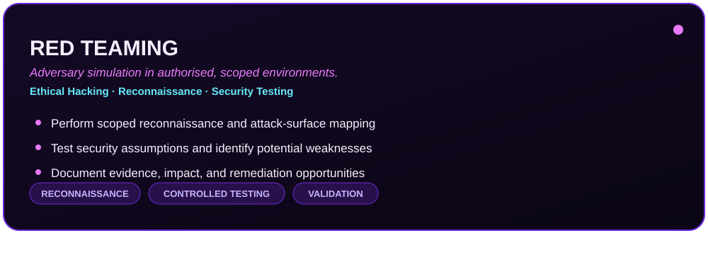
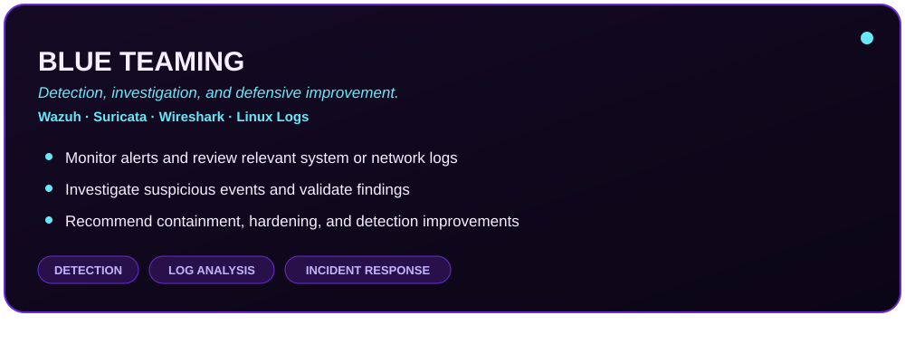
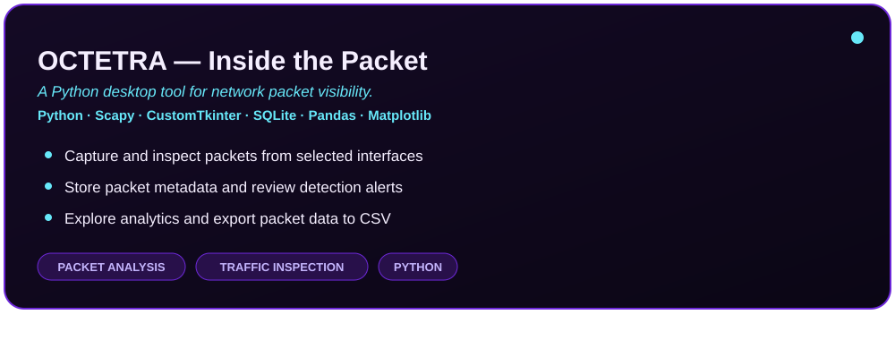
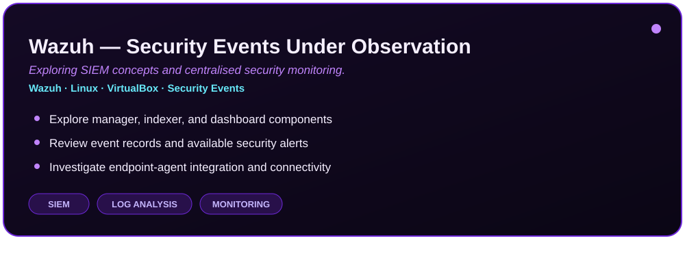
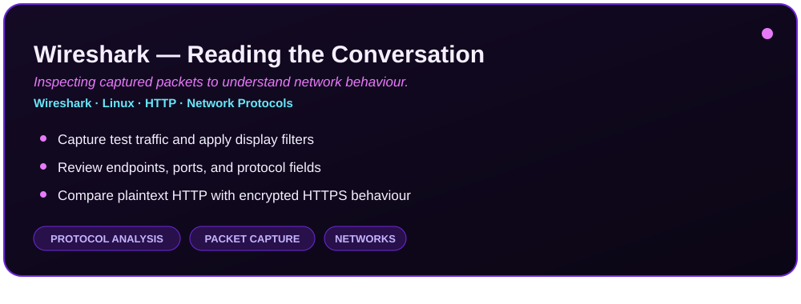
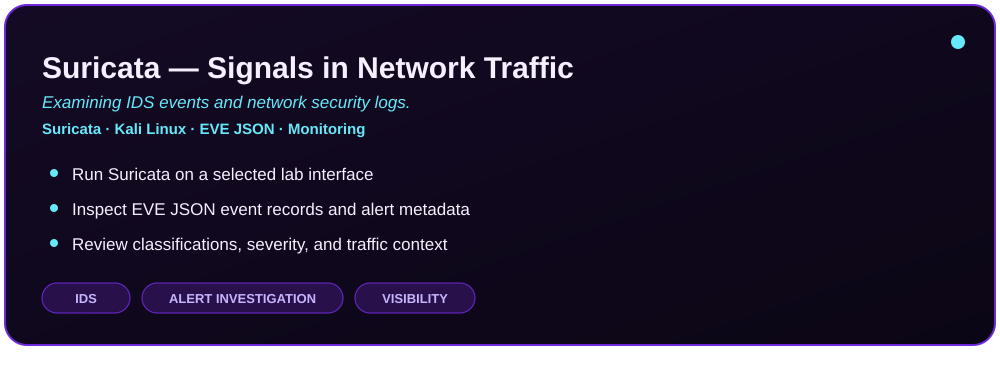
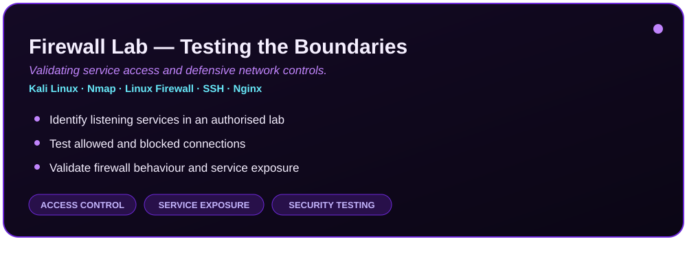
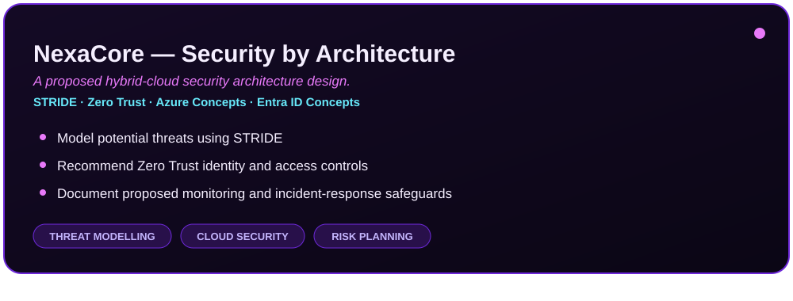

 <p align="center">
  
</p>

<p align="center">
  
</p>

<p align="center">
  
  
  
</p>

<p align="center">
  <a href="#-01--the-analyst-behind-the-terminal">About</a> •
  <a href="#-02--where-my-security-interests-lie">Focus</a> •
  <a href="#-03--red-teaming--blue-teaming">Red Team / Blue Team</a> •
  <a href="#-04--academic-foundation">Education</a> •
  <a href="#-05--tools-in-my-security-toolkit">Skills</a> •
  <a href="#-06--projects-from-the-lab">Projects</a> •
  <a href="#-07--from-observation-to-finding">Workflow</a> •
  <a href="#-08--principles-behind-my-practice">Principles</a> •
  <a href="#-09--the-skills-im-building-next">Roadmap</a> •
  <a href="#-12--lets-connect-and-exchange-knowledge">Connect</a>
</p>

---

## 🧬 01 | The Analyst Behind the Terminal

*Understanding systems, investigating activity, and learning to defend digital environments.*

I'm Jessica Edward, an aspiring **Cybersecurity Analyst** with a background in software engineering and a growing focus on network security, security monitoring, Linux environments, and vulnerability assessment.

I enjoy exploring how systems communicate, examining network traffic, identifying potential security weaknesses, and understanding how defensive controls help protect digital infrastructure.

My approach combines hands-on experimentation, analytical thinking, and technical documentation. Through practical labs and development projects, I am building my knowledge of defensive security, intrusion detection, vulnerability assessment, and incident investigation.

- 🔐 **Career direction:** Cybersecurity Analysis
- 🌐 **Network interests:** Traffic inspection, service discovery, and firewall testing
- 🛡️ **Defensive security:** IDS alerts, SIEM concepts, and event investigation
- 🐧 **Systems:** Linux, Windows, and virtualised lab environments
- 🐍 **Development:** Python scripting and packet analysis
- 📚 **Approach:** Practical experimentation, evidence-based analysis, and continuous learning

---

## 🎯 02 | Where My Security Interests Lie

*The disciplines and technical areas shaping my cybersecurity journey.*

<details>
<summary><b>🔍 Network Security & Visibility</b></summary>

Understanding protocols, ports, services, traffic flows, and potential network exposure through authorised testing.

</details>

<details>
<summary><b>🛡️ Security Monitoring & Detection</b></summary>

Exploring security events, alert classifications, endpoint monitoring, and intrusion-detection technologies.

</details>

<details>
<summary><b>🔎 Vulnerability Assessment</b></summary>

Learning to identify exposed services, investigate potential weaknesses, and document defensive recommendations.

</details>

<details>
<summary><b>🚨 Incident Investigation</b></summary>

Developing a structured approach to reviewing logs, validating suspicious activity, and preserving useful evidence.

</details>

<details>
<summary><b>☁️ Cloud & Identity Security</b></summary>

Exploring Zero Trust, identity and access management, threat modelling, and cloud security architecture.

</details>

---

## 🟣 03 | Red Teaming & Blue Teaming

*Learning both sides of security: how attacks are assessed and how systems are monitored, detected, and defended.*

<p align="center">
  
  
</p>

- **Red Teaming:** Building skills in authorised reconnaissance, service enumeration, vulnerability assessment, and controlled security testing.
- **Blue Teaming:** Building skills in security monitoring, alert review, network traffic analysis, log investigation, and incident response.
- **Combined perspective:** Using observations from controlled testing to better understand detection opportunities and defensive improvements.

*All testing is limited to systems and lab environments for which permission has been granted.*

---

## 🎓 04 | Academic Foundation

*Software engineering knowledge applied to the challenges of information security.*

<p align="center">
  
</p>

### Higher National Diploma (HND) in Computing — Software Engineering

**Knowledge domains**

- Software Development and Programming
- Cybersecurity and Information Security
- Computer Networking
- Database Systems and SQL
- Web Development Technologies
- Operating Systems and System Design
- Cloud Computing Concepts

My academic background provides a foundation for understanding applications, databases, networks, and operating systems from both a software engineering and security perspective.

---

## 🧰 05 | Tools in My Security Toolkit

*Technologies I use to explore networks, inspect traffic, and investigate system activity.*

### 🔎 Network Visibility & Assessment

<p>
  
  
  
  
</p>

- Network discovery and service enumeration
- Packet capture and protocol inspection
- Firewall and port accessibility testing
- Routing, VLANs, and network configuration

### 🛡️ Detection, Monitoring & Investigation

<p>
  
  
  
</p>

- IDS concepts and alert investigation
- EVE JSON security event inspection
- SIEM and endpoint-monitoring concepts
- Vulnerability scanning and findings review

### 🐧 Systems & Command-Line Operations

<p>
  
</p>

- Linux command-line operations
- Service management and troubleshooting
- VirtualBox lab environments
- Shell scripting and system administration fundamentals

### 💻 Programming & Data Analysis

<p>
  
</p>

- Python and Scapy for network analysis
- SQLite, SQL, and database management
- HTML, CSS, and JavaScript
- Git and GitHub version control
- pandas, Matplotlib, and Power BI for data analysis and visualisation

---

## 🚀 06 | Projects From the Lab

*Practical experiments that turn cybersecurity concepts into demonstrable technical work.*

### 📡 OCTETRA — Inside the Packet

<p align="center">
  
</p>

**Stack:** Python · Scapy · CustomTkinter · SQLite · Pandas · Matplotlib

A Python-based network packet analysis application designed to capture and inspect network traffic through a graphical interface.

**Key capabilities**
- Capture and inspect packets from selected network interfaces.
- Store packet information in an SQLite database.
- Display detection alerts and packet analytics.
- Export packet data to CSV for further analysis.
- Present network information through a desktop GUI.

**Security relevance:** Network visibility, protocol analysis, traffic investigation, and security-oriented data exploration.

---

### 🖥️ Wazuh — Security Events Under Observation

<p align="center">
  
</p>

**Stack:** Wazuh · Linux · VirtualBox · Security Events

A hands-on lab exploring security event collection and monitoring in a virtualised environment.

**Key activities**
- Explore the roles of the Wazuh manager, indexer, and dashboard.
- Investigate endpoint agent integration and event collection.
- Review available security alerts and event-monitoring workflows.
- Troubleshoot service availability and component connectivity.

**Security relevance:** SIEM concepts, log analysis, endpoint monitoring, and alert investigation.

---

### 🦈 Wireshark — Reading the Conversation

<p align="center">
  
</p>

**Stack:** Wireshark · Linux · HTTP · Network Protocols

A practical exercise investigating network communications through packet capture and protocol inspection.

**Key activities**
- Generate test HTTP traffic using command-line tools.
- Capture traffic and apply display filters.
- Examine source and destination addresses, ports, and protocols.
- Investigate the differences between HTTP and encrypted HTTPS communications.

**Security relevance:** Protocol analysis, network troubleshooting, and understanding the exposure of unencrypted traffic.

---

### 🚨 Suricata — Signals in Network Traffic

<p align="center">
  
</p>

**Stack:** Suricata · Kali Linux · EVE JSON · Network Monitoring

A practical lab exploring network-based intrusion detection and security event logging.

**Key activities**
- Run Suricata against a selected lab network interface.
- Inspect EVE JSON event logs.
- Review generated alerts, classifications, and severity levels.
- Examine the source and destination details associated with events.

**Security relevance:** IDS concepts, detection-rule evaluation, event investigation, and network visibility.

---

### 🔐 Firewall Lab — Testing the Boundaries

<p align="center">
  
</p>

**Stack:** Kali Linux · Nmap · Linux Firewall · SSH · Nginx

A controlled networking exercise focused on checking service accessibility and validating firewall behaviour.

**Key activities**
- Identify listening services and exposed ports.
- Test permitted and blocked connections.
- Review the behaviour of SSH and web services.
- Validate firewall rules using controlled network tests.

**Security relevance:** Attack-surface awareness, service exposure, access control, and defensive configuration testing.

---

### ☁️ NexaCore — Security by Architecture

<p align="center">
  
</p>

**Stack:** STRIDE · Zero Trust · Azure Concepts · Entra ID Concepts

A proposed security architecture for a hypothetical hybrid-cloud organisation.

**Key activities**
- Identify potential threats using the STRIDE methodology.
- Develop Zero Trust access-control recommendations.
- Propose identity, monitoring, and incident-response controls.
- Document security risks, mitigations, and architecture decisions.

**Security relevance:** Threat modelling, cloud security design, identity management, and risk-based control planning.

*This project represents architecture design and recommendations, not a deployed Azure environment.*

<p align="center">
  <a href="https://github.com/jessicaedward1707?tab=repositories">
    
  </a>
</p>

---

## 🔬 07 | From Observation to Finding

*A repeatable investigation process built around evidence, validation, and risk reduction.*

```text
       ┌───────────────────────────┐
       │  01. Define the Scope     │
       └─────────────┬─────────────┘
                     ↓
       ┌───────────────────────────┐
       │  02. Identify Assets      │
       │      and Services         │
       └─────────────┬─────────────┘
                     ↓
       ┌───────────────────────────┐
       │  03. Collect Evidence     │
       │      Traffic / Logs       │
       └─────────────┬─────────────┘
                     ↓
       ┌───────────────────────────┐
       │  04. Analyse Observations │
       └─────────────┬─────────────┘
                     ↓
       ┌───────────────────────────┐
       │  05. Validate Findings    │
       └─────────────┬─────────────┘
                     ↓
       ┌───────────────────────────┐
       │  06. Assess Potential Risk│
       └─────────────┬─────────────┘
                     ↓
       ┌───────────────────────────┐
       │  07. Document Mitigations │
       └───────────────────────────┘
```

My goal is to connect technical observations to defensible conclusions and practical security recommendations.

---

## 🧭 08 | Principles Behind My Practice

*Ethical testing, careful analysis, reproducible results, and clear technical documentation.*

| Principle | How I Apply It |
|---|---|
| Responsible testing | Work only within authorised environments and agreed scope. |
| Evidence first | Base conclusions on observable traffic, logs, and test results. |
| Verification | Validate findings instead of assuming every alert is a confirmed incident. |
| Risk awareness | Consider impact, exposure, and appropriate defensive measures. |
| Clear reporting | Record methods, results, limitations, and remediation recommendations. |
| Continuous learning | Refine skills through practical labs, research, and reflection. |

---

## 🗺️ 09 | The Skills I'm Building Next

*My roadmap for strengthening detection, incident response, vulnerability assessment, and cloud security.*

- [x] Explore Linux environments and command-line tools.
- [x] Practise network scanning and service discovery in lab environments.
- [x] Capture and inspect network traffic with Wireshark.
- [x] Develop a Python-based packet analysis application.
- [x] Explore Suricata event logging and IDS alerts.
- [ ] Strengthen Wazuh endpoint monitoring and SIEM investigation workflows.
- [ ] Practise analysing authentication, system, and network logs.
- [ ] Improve incident triage and security report writing.
- [ ] Expand vulnerability assessment and remediation documentation.
- [ ] Explore cloud security monitoring and identity protection.
- [ ] Build repeatable detection and response exercises in isolated labs.

---

## 📈 10 | My Open-Source Footprint

*An overview of coding activity and public repositories, where GitHub's statistics services are available.*

<p align="center">
  
  
</p>

<p align="center">
  
</p>

---

## 🌐 11 | Beyond the Security Lab

*The technologies and security disciplines I continue to explore.*

- Security Operations and Incident Response
- Network Defence and Intrusion Detection
- Vulnerability Assessment and Remediation
- Linux Security and Automation
- Cloud Security and Zero Trust
- Python-Based Security Tools
- Secure Software Development
- Critical Infrastructure Security
- Security Architecture and Threat Modelling

I enjoy understanding how software, networks, and infrastructure interact, and how thoughtful engineering can improve the security and reliability of digital environments.

---

## 📫 12 | Let's Connect and Exchange Knowledge

*Connecting with people who value thoughtful engineering, practical security, and continuous learning.*

I'm interested in connecting with cybersecurity professionals, developers, and learners to exchange knowledge, discuss technical projects, and explore opportunities to grow in cybersecurity.

<p align="center">
  <a href="https://github.com/jessicaedward1707">
    
  </a>
  <a href="https://www.linkedin.com/in/jessica-edward-07141014b/">
    
  </a>
</p>

<p align="center">
  <i>Investigate with curiosity. Validate with evidence. Defend with purpose.</i>
</p>

<p align="center">
  
</p>
